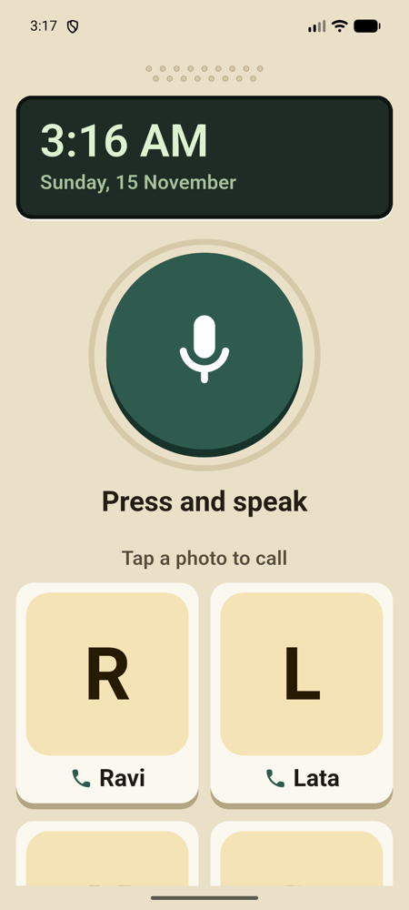
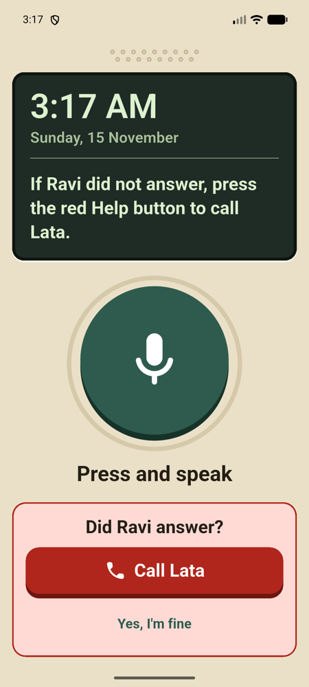
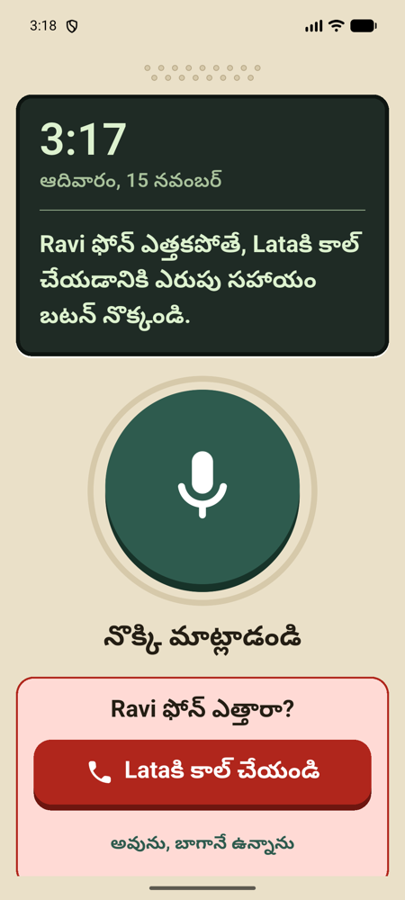
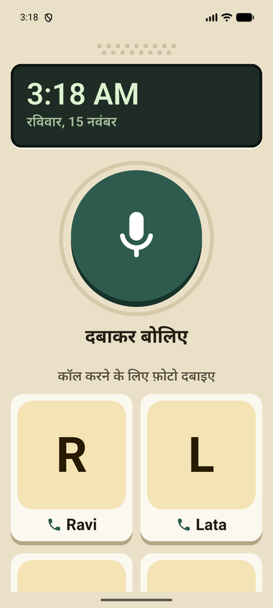
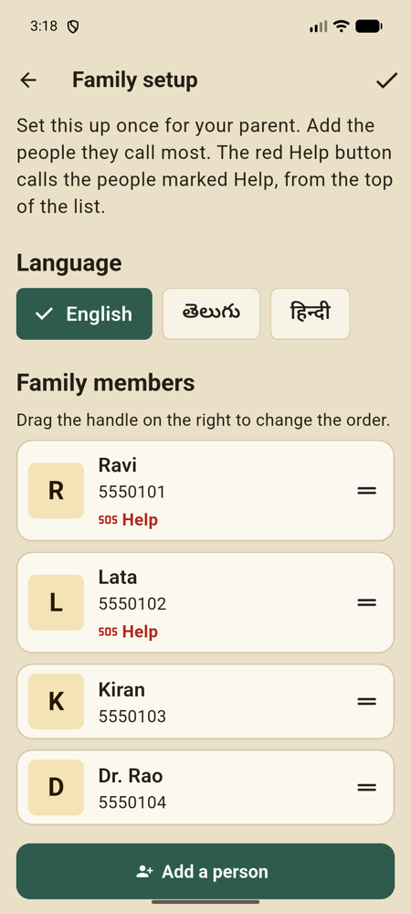
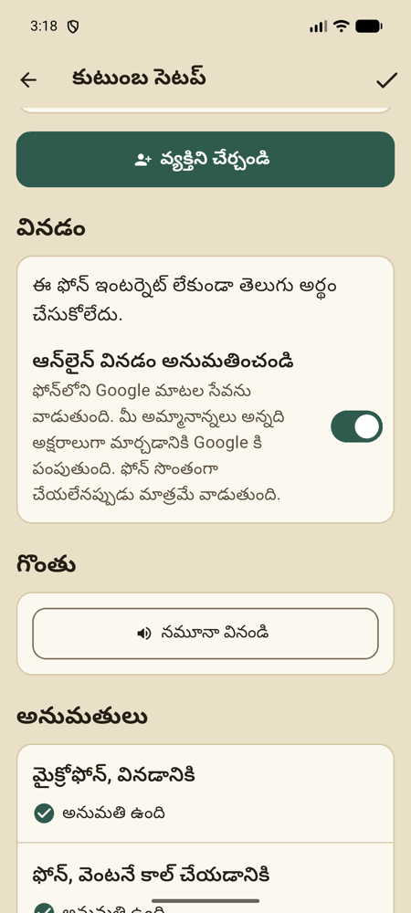
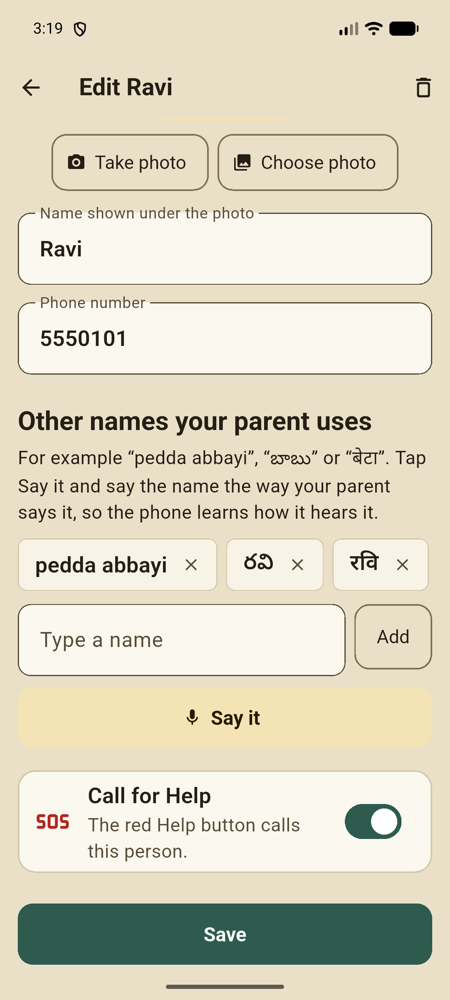
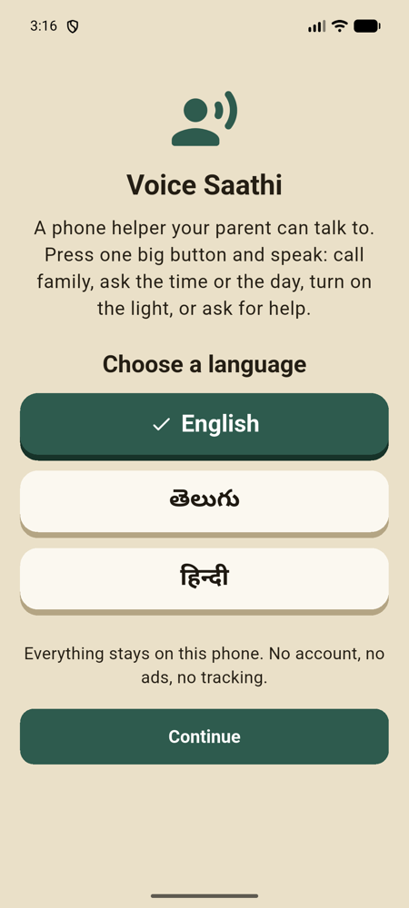

# Voice Saathi

[](https://github.com/ChandraChaan/voice-saathi/actions/workflows/ci.yml)


[](LICENSE)

**A phone helper for elderly parents, built like an old push-button home phone.** They press one big button and speak in **Telugu, Hindi or English**. The phone answers out loud and does it: calls a son or daughter, tells the time or the day, reads the battery level, turns on the torch, or calls family for help.

A son or daughter sets it up once. No account, no ads, no tracking. The app has no internet permission at all.

<p align="center">
  
  
  
  
</p>
<p align="center">
  
  
  
  
</p>

## What your parent can say

Words can be mixed ("light on చెయ్యి" works). Each language's words are understood whatever language the app is set to.

| To | English | తెలుగు | हिन्दी |
|---|---|---|---|
| Call someone | "Call Ravi", "phone pedda abbayi", or just "Ravi" | "రవికి ఫోన్ చెయ్యి", "లతతో మాట్లాడాలి" | "रवि को फोन लगाओ", "बेटी से बात कराओ" |
| Ask for help | "Help", "emergency" | "కాపాడండి", "సహాయం" | "बचाओ", "मदद" |
| The time | "What time is it?" | "టైం ఎంత అయింది?" | "कितने बजे हैं?" |
| The day and date | "What day is today?" | "ఈరోజు ఏ రోజు?" | "आज कौन सा दिन है?" |
| The battery | "How much battery?" | "బ్యాటరీ ఎంత ఉంది?" | "बैटरी कितनी है?" |
| The torch | "Light on", "light off" | "లైట్ వెయ్యి", "లైట్ ఆపు" | "टॉर्च जलाओ", "लाइट बंद करो" |

If the phone doesn't catch a name, the photo keys below the talk key always work.

## How it works

- **The talk key.** Press once and speak; it stops listening when your parent stops talking. The display shows what it heard and the answer, and the answer is read aloud slowly.
- **Calling.** Before dialling, the phone says "Calling Ravi." With the Phone permission it calls straight away. Without it, the dialer opens with the number filled in and your parent presses the green button.
- **Help.** The red Help key, or saying "help", calls the people marked **Help** in the order of the family list. When your parent comes back to the app after the call, it asks "Did Ravi answer?" and offers a big key to call the next person. "Yes, I'm fine" clears it.
- **Names the way your parent says them.** Each person can have other names ("pedda abbayi", "బాబు", "बेटा"). **Say it** in the form listens once and saves the name exactly as the phone hears it, which is the surest way to make voice calling work.
- **Family setup opens on a long press,** so a stray tap doesn't take your parent there.

## Privacy and listening

Speech is turned into text by Android's own speech recogniser, not by this app.

- **On the phone (default).** On Android 12 and newer phones that have an on-device recogniser, the app uses only that one, so nothing your parent says leaves the phone. Family setup shows whether the chosen language is ready offline and, where Google offers it, a button to download it once.
- **Online, only if you switch it on.** If the language can't be recognised on the phone, listening stays off until the family turns on **Allow online listening**. That uses the phone's Google speech service, which sends the audio to Google to turn it into text.
- **The app itself can't go online.** It has no `INTERNET` permission (CI fails the build if it ever gets one). Family names, numbers, photos and settings stay in the app's private folder.

What I saw on a Pixel emulator with Android 17 (Google APIs image): English and Hindi could be downloaded for offline use (Hindi was 61 MB). Telugu was not offered offline, so Telugu needed online listening there. Other phones may differ, and Family setup shows what the phone itself reports.

Permissions: **microphone** (to listen) and **phone** (to call straight away). Both are optional; without the microphone the photo keys still call.

## Please note

- This is not an emergency service. Help calls your family's numbers; it does not call 112 or an ambulance.
- Phones can be switched off, run out of battery, lose signal or be on silent. Please don't rely on any app alone for anything critical.
- Speech recognition makes mistakes, more so with older voices and noisy rooms. The app always says who it's calling before it dials, and shows what it heard.

## Download

APKs will be attached to [Releases](https://github.com/ChandraChaan/voice-saathi/releases) once a version is tagged. Pick `arm64-v8a` for almost any phone from the last six or seven years, `armeabi-v7a` for older 32-bit phones, or `universal` if unsure. Each release lists SHA-256 checksums in `SHA256SUMS`.

## Build it yourself

Needs Flutter 3.44 (stable) and the Android SDK.

```bash
flutter pub get
flutter test
flutter run
```

On a phone or emulator, `flutter test integration_test` checks the Kotlin side (battery, torch, speech status).

## Project layout

```
lib/
  core/platform/        Kotlin bridges: speech recogniser, phone (calls, battery, torch), permissions
  features/assistant/   command matching (domain/) and the home screen with the talk key
  features/family/      family members and their nicknames
  features/settings/    language, online listening, welcome and Family setup
android/app/src/main/kotlin/dev/chandra/voice_saathi/
  SpeechChannel.kt      on-device first recognition, offline-language check and download
  PhoneChannel.kt       calls, battery level, torch
```

## License

[MIT](LICENSE) © 2026 Chandra ObulaReddy
